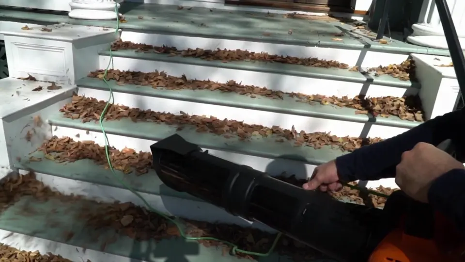
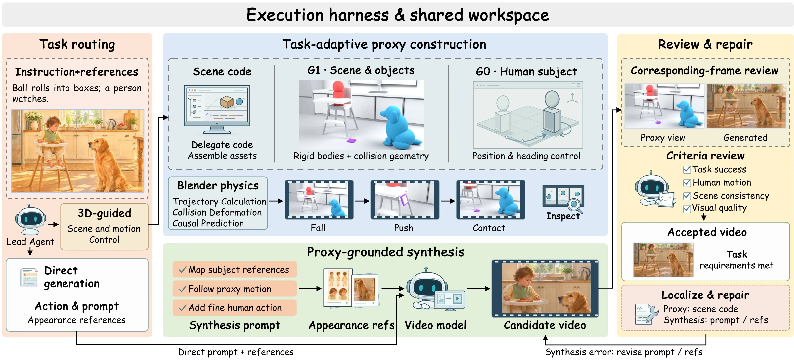
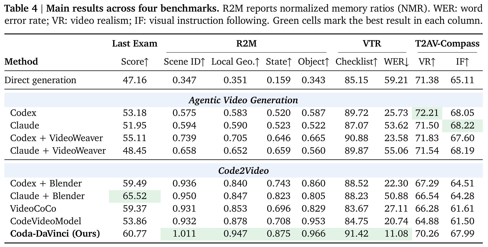

# Coda-DaVinci

**Task-adaptive video generation with coding agents and 3D proxies.**

Coda-DaVinci combines scene construction with video generation. It chooses a
workflow from the requested task, builds a reusable Blender scene when explicit
control is useful, and uses the rendered proxy to guide the video model. The
coding agent inspects the generated video, while an independent reviewer checks
it against task-specific acceptance criteria.

[Paper](https://arxiv.org/abs/2611.26595) · [Project page](https://coda-davinci.github.io/)

[Examples](#examples) · [Installation](#installation) · [Generate a video](#generate-a-video) · [Results](#results)

## Examples

Click a preview to watch the generated video. The [project page](https://coda-davinci.github.io/#showcase)
includes synchronized comparisons with direct generation and other coding-agent methods.

| Cutting a rice roll | Clearing leaves | A runner and a car |
| :---: | :---: | :---: |
| [](https://coda-davinci.github.io/assets/rice-harness.mp4) | [](https://coda-davinci.github.io/assets/leaves-harness.mp4) | [](https://coda-davinci.github.io/assets/long-runner-harness-8s.mp4) |
| Fine hand motion around a simple proxy. | Scene changes persist across a camera revisit. | Subject continuity through a longer sequence. |
| [Play video](https://coda-davinci.github.io/assets/rice-harness.mp4) · [3D proxy](https://coda-davinci.github.io/assets/rice-harness-proxy.mp4) | [Play video](https://coda-davinci.github.io/assets/leaves-harness.mp4) · [3D proxy](https://coda-davinci.github.io/assets/leaves-harness-proxy.mp4) | [Play video](https://coda-davinci.github.io/assets/long-runner-harness-8s.mp4) |

## Workflow



1. **Route the task.** A capability assessment selects Blender for explicit spatial,
   physical or persistent-state control. Natural articulated motion can use direct
   generation when scene control is unnecessary.
2. **Construct the proxy.** The root agent delegates scoped work, assembles the scene
   and plans the camera. Environments and props retain coarse structure; people
   use a cylinder torso and sphere head. Task-relevant physics drives the animation.
3. **Bind and generate.** Stable proxy colors identify subjects in the generation
   prompt. User media or generated appearance references supply the intended look.
4. **Inspect and repair.** The root views the proxy and final frames, then requests
   independent acceptance. The controller allows up to three repairs and records
   unresolved issues with the delivered result.
5. **Continue a scene.** Sequential clips reuse scene files, subject identities and
   the previous clip's actual final frame.

The harness gives the agent tools to edit scene code, run Blender, render previews,
inspect images and video frames, manage subject references, and request video
generation. Delegated agents work on scoped tasks and return assets to the shared
scene. The bundled [skills](src/coda_davinci/resources/skills) provide guidance for
modeling, camera motion, physics and visual review.

## Installation

Use **Linux, Python 3.11 or 3.12, and an NVIDIA GPU with a working CUDA driver**.
Blender renders with Cycles CUDA. Models are accessed through configured APIs.

From the repository root, create an environment and install the package:

```bash
python3.12 -m venv .venv
source .venv/bin/activate
python -m pip install --upgrade pip
python -m pip install -e .
```

Install FFmpeg 6 or newer and bubblewrap with your system package manager. On Ubuntu/Debian:

```bash
sudo apt-get update
sudo apt-get install ffmpeg bubblewrap libxrender1 libxi6 libxkbcommon0 libsm6 libgl1
```

### Blender

Download a Linux build from [Blender](https://www.blender.org/download/), extract
the **complete distribution**, and place its contents under `external/blender/`:

```text
external/blender/
├── blender
├── lib/
└── <Blender version>/
```

For example, after downloading an archive:

```bash
mkdir -p external/blender
tar -xf /path/to/blender-<version>-linux-x64.tar.xz \
    --strip-components=1 -C external/blender
external/blender/blender --background --version
```

Set `BLENDER_VERSION` to the installed version. You can also set
`BLENDER_EXECUTABLE` to an existing installation's absolute executable path.
The framework requires Blender's bundled Python, Cycles and simulation modules.

### API configuration

```bash
cp .env.example .env
```

Fill in the three independently configured services:

| Service | Variables | Required interface |
| --- | --- | --- |
| Coding agent and acceptance reviewer | `MODEL`, `BASE_URL`, `API_KEY`, `AGENT_PROTOCOL` | Responses, Chat Completions, Anthropic Messages, or Gemini native |
| Appearance image generation/editing | `IMAGE_MODEL`, `IMAGE_BASE_URL`, `IMAGE_API_KEY` | OpenAI-compatible Images API |
| Final video generation | `VIDEO_MODEL`, `VIDEO_MODEL_BASE_URL`, `VIDEO_MODEL_API_KEY` | Media upload plus asynchronous video generation |

The coding model needs **image understanding and tool calling**. The same model
configuration serves routing, the lead agent, delegated agents and the acceptance
reviewer. Choose its API interface through `AGENT_PROTOCOL`:

| `AGENT_PROTOCOL` | Coding service interface |
| --- | --- |
| `responses` | OpenAI-compatible Responses API |
| `chat` | OpenAI-compatible Chat Completions API |
| `anthropic` | Anthropic Messages API |
| `gemini` | Gemini native API |

The image service creates or edits appearance references when the task needs them.
The video service turns the prompt and reference media into the final video. These
services can have separate endpoints and credentials. Fill in all three groups in
your `.env` with your deployment's model IDs, URLs and API keys.

The bundled video client implements the gateway contract documented in
[Provider configuration](docs/providers.md). Confirm that your video endpoint
implements this contract, including reference image and reference video inputs.
The model identifier is passed through to that service. Set resolution and duration
to values supported by the chosen model.

Choose the visible GPU before running:

```bash
export CUDA_VISIBLE_DEVICES=0
coda-davinci doctor
```

`doctor` checks configuration presence, executable availability and the NVIDIA
driver. API credentials and model permissions are checked when making requests.
Environment variables already exported in the shell take precedence over `.env`.
Use `coda-davinci --env-file /path/to/config.env generate ...` for another config.

## Generate a video

Run commands from the repository root when using the default relative Blender path.

### Text input

```bash
coda-davinci generate --prompt-file examples/scene.txt --duration 8
```

The default route is adaptive. `examples/motion.txt` provides a natural-motion
request that the router can assess independently.

```bash
coda-davinci generate --prompt-file examples/motion.txt --duration 8 \
    --output-dir outputs/motion
```

Describe the desired action, camera behavior and visual appearance in the prompt.
For tasks with persistent state, include what should remain visible or unchanged
when the camera returns. The duration applies to the requested output clip;
`VIDEO_RESOLUTION` and `VIDEO_ASPECT_RATIO` in `.env` set its output format.

### Image or video references

```bash
coda-davinci generate \
    --prompt "The character places the cup on the table and walks toward the window." \
    --reference-image "character=/absolute/path/character.png" \
    --duration 8

coda-davinci generate \
    --prompt "Continue the camera movement while preserving the objects in this room." \
    --reference-video "room=/absolute/path/room.mp4" \
    --duration 8
```

Repeat either reference option to supply additional media. Labels are retained
through planning and prompt binding. Images are submitted as **reference images**.

For example, use `--reference-image "character=..."` and
`--reference-image "room=..."` together, and describe their roles in the prompt.
The agent can then bind a subject's appearance to the corresponding reference
while using the proxy video for scene layout and motion.

### Sequential clips

```bash
coda-davinci generate \
    --prompt "A small studio with a wooden desk, a red chair and one window." \
    --interactions examples/continuation.json
```

Each turn declares its own prompt and duration. The controller reveals one turn at
a time, reuses the workspace and provides the previous final frame. Returned clips
and their individual delivery records are listed in `episode_result.json`.

The interactions file has the following structure; turn numbers start at 1 and
increase consecutively:

```json
{
  "turns": [
    {"turn": 1, "duration_seconds": 8, "prompt": "Move around the desk and stop facing the window."},
    {"turn": 2, "duration_seconds": 8, "prompt": "Turn back toward the desk. The same red chair is still beside it."}
  ]
}
```

The initial `--prompt` establishes the shared scene. Each turn supplies the next
action, and `duration_seconds` sets that turn's clip length. See
[examples/continuation.json](examples/continuation.json) for a complete example.

### Concurrency

```bash
coda-davinci generate --prompt-file examples/scene.txt \
    --parallel-agents 3 --parallel-renders 1
```

These limits apply within one task, including its children. Independent tasks can
run in separate processes with their own `CUDA_VISIBLE_DEVICES` and output directory.
Blender rendering guidance uses four samples, four CPU threads and persistent scene
data. Plan process counts around GPU memory, CPU capacity and provider rate limits.

## Outputs

Each invocation creates a unique directory under `outputs/`:

```text
outputs/<timestamp>_<id>/
├── episode.json                 # Task, selected route and model IDs
├── episode_result.json          # Completion status and delivered video paths
├── usage.json                   # Deduplicated API usage records, where available
├── scene/
│   ├── .harness/                # Conversations, routing and acceptance records
│   ├── .skills/                 # Skills loaded by this agent
│   ├── renders/                 # Proxy frames, scene checkpoints and videos
│   ├── video_generations/       # Submitted revisions and downloaded final videos
│   └── Final View/              # Delivered video and delivery record
└── agents/                       # Delegated workspaces and asset deliveries
```

The JSON delivery record is the authoritative path to each generated video.
Generation requests keep task IDs and revision records so retries within an active
task can poll an existing submission. Failed attempts remain available for diagnosis.

After a run, open `episode_result.json` to locate the delivered video. To understand
a routing choice, read `scene/.harness/route_decision.json`; to inspect review
feedback, look under `scene/.harness/acceptance/`. Scene code and Blender assets
remain in the episode workspace for inspection and reuse. `usage.json` summarizes
reported model-token usage for the episode.

## Results

The paper evaluates physical behavior, instruction following, scene consistency
and visual quality across World Models' Last Exam in Physics, R2M-Bench, VTR-Bench
and T2AV-Compass. The table below is taken from the project page; green cells mark
the best result in each column.

[](https://coda-davinci.github.io/#results)

See the [paper](https://arxiv.org/abs/2611.26595) for the evaluation protocol and
ablations, and the [video comparisons](https://coda-davinci.github.io/#showcase)
for the corresponding prompts, reference images and available proxies.

## Project layout

```text
src/coda_davinci/
├── agents/       # Model loops, delegation, context management and acceptance
├── blender/      # GPU setup and standalone Blender workers
├── media/        # Video inspection, encoding, subject registry and reference media
├── providers/    # Coding, image and video API clients
├── resources/    # Bundled skills, modeling policy and inspection pages
├── runtime/      # Configuration, filesystem sandbox and skill loading
├── tools/        # Agent-facing tools and asynchronous jobs
├── workflow/     # Routing, proxy binding, generation, delivery and continuation
├── application.py
└── cli.py
```

See [Architecture](docs/architecture.md), [Provider configuration](docs/providers.md)
and [Troubleshooting](docs/troubleshooting.md).

## Development

```bash
python -m pip install -e '.[dev]'
pytest -q
python -m build
```

The tests exercise routing, tool permissions, reference binding, the acceptance
repair budget and the video gateway using local fixtures. GPU rendering and live
API calls depend on your installed Blender and configured services.

Contributions are welcome; see [CONTRIBUTING.md](CONTRIBUTING.md).

## License

[Apache-2.0](LICENSE).
