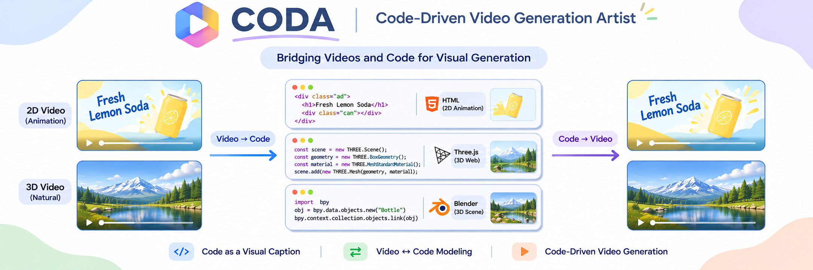
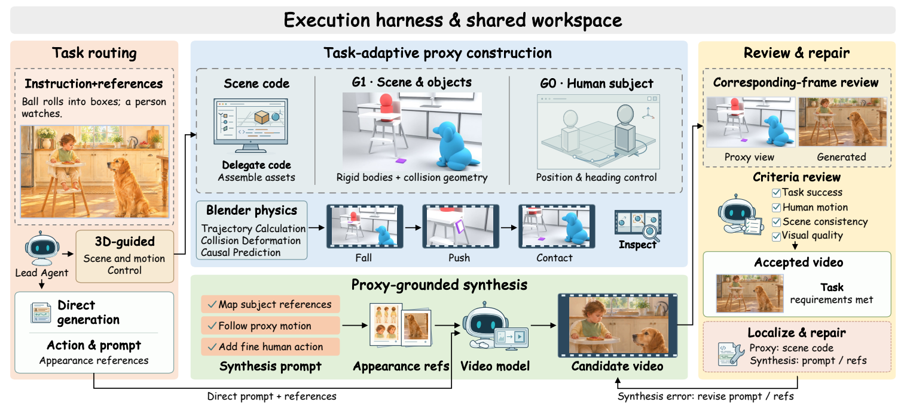
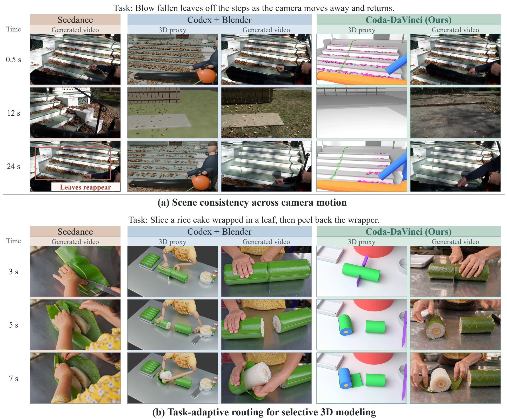
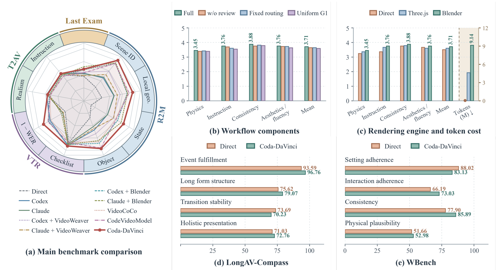

# 

<p align="center">
  
</p>

CODA is a series of works that bridges videos and code for visual generation. The series covers two directions:

- **Video → Code:** model 2D videos as HTML animations and 3D videos as Three.js scenes, so that a video is captured by executable code.
- **Code → Video:** use executable code to guide video generation, with HTML for 2D animation and Blender / Three.js 3D proxies for scene layout, motion, and physical interactions.

Works in the series:

- **Coming soon**: [Coda-DaVinci: Reimagining Video Generation with Code2Video](#coda-davinci)
- **Coming soon**: Video → Three.js: modeling 3D videos as executable Three.js scenes
- **2026/10**: [CodeCap-Bench: Can Code Serve as a Good Video Caption?](https://arxiv.org/abs/2610.37341) (Arxiv 2026)

## 📜 News

[2026/11] 🔥 **Coda-DaVinci: Reimagining Video Generation with Code2Video** is coming soon! See the [overview](#coda-davinci) below.

[2026/11] 🔥 The [dataset](https://huggingface.co/datasets/kevintank/CodeCap-Dataset) and [inference and evaluation code](CodeCap-Bench/README.md) of **CodeCap-Bench** are released !
[2026/10] 🔥 The [paper](https://arxiv.org/abs/2610.37341) and [project page](https://codecap-bench.github.io/) of **CodeCap-Bench** are released !

## 📋 Todo List

- [X] [Paper (CodeCap-Bench)](https://arxiv.org/abs/2610.37341)
- [X] [Dataset (CodeCap-Bench)](https://huggingface.co/datasets/kevintank/CodeCap-Dataset)
- [X] [Inference and evaluation guide (CodeCap-Bench)](CodeCap-Bench/README.md)
- [ ] Video → Three.js modeling for 3D videos (coming soon)
- [ ] Coda-DaVinci release (coming soon)

## 🗂️ Resources

| Work                         | Paper                                    | Project Page                                               | Dataset                                                                        | Code                                    |
| ---------------------------- | ---------------------------------------- | ---------------------------------------------------------- | ------------------------------------------------------------------------------ | --------------------------------------- |
| CodeCap-Bench                | [arXiv](https://arxiv.org/abs/2610.37341) | [codecap-bench.github.io](https://codecap-bench.github.io/) | [🤗 CodeCap-Dataset](https://huggingface.co/datasets/kevintank/CodeCap-Dataset) | [CodeCap-Bench](CodeCap-Bench/README.md) |
| Video → Three.js            | Coming soon                              | Coming soon                                                | Coming soon                                                                    | Coming soon                             |
| [Coda-DaVinci](#coda-davinci) | Coming soon | Coming soon | — | Coming soon |

## 💡 Motivation

Video captions and video generation prompts mostly use natural language. Fine-grained spatial structure and temporal dynamics, such as complex layouts, motion trajectories, camera movement, and coordinated state changes, are hard to state precisely in text and lead to long, ambiguous descriptions. Executable code describes the same content through graphical primitives, layout rules, and functions of time:

- **Rule-based spatial structure:** layout rules, scene graphs, and shared drawing functions describe elements and their spatial relationships compactly.
- **Computable temporal evolution:** time functions specify intervals, displacement, and easing, so the visual state can be computed at any moment.
- **Executable visual specification:** rendering the code yields a video, so a code caption can be checked against the reference video and used as a precise control signal for generation.

The CODA series studies three questions:

- **Code as a Visual Caption:** Can code serve as a good caption of 2D and 3D videos?
- **Video ↔ Code Modeling:** Can models faithfully translate videos into HTML or Three.js code, and render code back into videos?
- **Code-Driven Video Generation:** Can executable representations, from HTML 2D animations to Blender / Three.js 3D proxies, guide video generation models to produce videos with accurate layout, motion, and timing?

<a id="coda-davinci"></a>

## 🎨 Coda-DaVinci

**Coda-DaVinci: Reimagining Video Generation with Code2Video** · **Coming soon**

Coda-DaVinci advances the **Code → Video** direction of the CODA series. It combines executable 3D scenes with video generation models to improve control over scene structure, motion, and physical interactions. Rather than constructing a detailed 3D proxy for every task, it selects between **proxy-guided generation** and **direct video generation** according to the task: explicit modeling provides structural control where needed, while the video model supplies appearance and fine motion.

<p align="center">
  
</p>

### ✨ Highlights

- **Task-adaptive 3D modeling:** Use medium-grained proxies for environments and structured objects, coarse proxies for human subjects, and Blender physics simulation for interactions that can be meaningfully simulated. Choose direct generation when explicit control is unnecessary and proxy animation risks unnatural motion.
- **Proxy-grounded video synthesis:** Inspect the rendered proxy, bind appearance references to the corresponding scene entities, and write synthesis prompts that follow the proxy's structure and motion while specifying finer visual details and human actions.
- **Persistent scenes and visual feedback:** A multi-agent harness preserves scene code and assets across revisions and successive requests. Corresponding-frame inspection and independent task review identify errors and guide repairs to scene code, prompts, or references.
- **Evidence-based workflow design:** Controlled experiments with blinded human evaluation study proxy granularity, physics simulation, and prompting, revealing task-dependent trade-offs between consistency and motion naturalness.

### 🎞️ Qualitative Examples

<p align="center">
  
</p>

**Scene consistency and selective 3D modeling.** Top: clearing fallen leaves while the camera moves away and returns tests whether the changed scene state persists. Bottom: Coda-DaVinci models the objects involved in slicing and unwrapping a rice cake, leaving detailed hand articulation to the video generator. Proxy frames and generated frames show how explicit scene control translates into the final video.

### 🚀 Main Results

The paper compares Coda-DaVinci with direct generation, agentic video generation, and Code2Video baselines. All methods in the main comparison use **Seedance 2.5** for video synthesis. Selected results against direct generation are shown below; ↑ / ↓ indicate whether higher / lower is better.

| Benchmark | Metric | Direct generation | Coda-DaVinci |
|---|---|---:|---:|
| VTR | Checklist satisfaction ↑ | 85.15 | **91.42** |
| VTR | Word error rate (%) ↓ | 59.21 | **11.08** |
| R2M | Scene identity (NMR) ↑ | 0.347 | **1.011** |
| R2M | Local geometry (NMR) ↑ | 0.351 | **0.947** |
| R2M | State (NMR) ↑ | 0.159 | **0.875** |
| R2M | Object (NMR) ↑ | 0.343 | **0.966** |
| World Models' Last Exam in Physics | Physics score ↑ | 47.16 | **60.77** |
| T2AV-Compass | Video realism ↑ | **71.38** | 70.26 |
| T2AV-Compass | Visual instruction following ↑ | 65.11 | **67.99** |

Bold marks the better value in each row; NMR denotes normalized memory ratio. T2AV-Compass results use 200 randomly sampled tasks. Coda-DaVinci leads the compared methods on all reported **VTR and R2M metrics**, improves physical plausibility over direct generation, and achieves the highest realism among the compared Code2Video methods, approaching direct generation. Physics performance remains below Claude + Blender (65.52).

<p align="center">
  
</p>

**Performance and ablation studies.** The figure summarizes normalized benchmark results, the effects of workflow components, the quality–cost trade-off between rendering engines, and long-video performance on LongAV-Compass and WBench.

Long-video evaluations on **29 LongAV-Compass cases** and **50 WBench cases** show gains in event fulfillment, long-form structure, interaction adherence, and consistency. Transition stability and adherence to scene settings remain limitations relative to direct generation.

## 🎬 CodeCap-Bench

<p align="center">
  
</p>

CodeCap-Bench is the first work of the CODA series. It asks whether code can serve as a good video caption, and whether current multimodal large language models (MLLMs) can generate faithful code captions. Under the evaluated settings, code captions retain more information than natural language captions: videos rendered from code support more accurate question answering and reconstruct the reference videos more faithfully.

CodeCap-Bench evaluates the code captioning capabilities of MLLMs on structured 2D videos. Given a reference video, a model writes a code caption in HTML, CSS, and JavaScript. All visual content must be generated programmatically, without reference frames or external visual assets. The code is rendered into a video and compared with the reference along three complementary dimensions.

<p align="center">
  
</p>

**Data.** 323 videos across five categories: desktop and application interfaces, 2D games, visual design and media animation, data and scientific visualization, and icons and abstract motion graphics. Videos average 19.01 seconds, with 16.8 annotated reference objects and 8.63 focal points per video. Each video has static and dynamic focal-point annotations and object-level spatio-temporal annotations, checked through human review.

<p align="center">
  
</p>

**Evaluation.**

| Metric                                    | Name in commands      | What it measures                                                        | How                                                                          |
| ----------------------------------------- | --------------------- | ----------------------------------------------------------------------- | ---------------------------------------------------------------------------- |
| Visual similarity                         | `visual_similarity` | Global consistency of visual content, appearance, and motion            | Cosine similarity of V-JEPA 2.1 video features                               |
| Object-level spatio-temporal IoU          | `object_st_iou`     | Whether key objects appear at the correct locations and times           | MLLM object localization + SAM 3.1 tracking                                  |
| Fine-grained visual information retention | `visual_retention`  | Static appearance and layout; dynamic motion, state changes, and timing | MLLM judge over annotated focal points (Pearson r = 0.942 with human scores) |

### ✨ Highlights

- 🔥 **Code as Video Caption:** CodeCap-Bench studies executable code as a complementary representation for preserving fine-grained visual information, spatial structure, and temporal dynamics. Rendering gives code captions an explicit visual interpretation that can be checked directly.
- 🔥 **Code Retains More Information than Language:** In the evaluated settings, videos rendered from code captions support more accurate question answering (Opus-5: 83.02% vs. 72.64% from natural language captions) and reconstruct the reference videos more faithfully than natural language captions turned into video by a video generation model.
- 🔥 **Multi-level Evaluation:** The benchmark measures global visual similarity, object-level spatio-temporal alignment, and fine-grained retention of static and dynamic focal points.
- 🔥 **Agentic and Non-agentic Settings:** Agentic models run in coding harnesses (Codex, Claude Code, Pi Agent) and refine their code with tools and rendering feedback; non-agentic models generate code in one pass.

### 🚀 Main Results

Results at medium thinking effort. All metrics are higher-is-better; IoU and retention use a 0–100 scale. Tasks that fail to produce a video receive 0 on the fidelity metrics.

| Setting     | Model               | Harness     | Video success (%) | Visual similarity | Spatio-temporal IoU | Retention (Dynamic) | Retention (Static) | Retention (Overall) |
| ----------- | ------------------- | ----------- | ----------------- | ----------------- | ------------------- | ------------------- | ------------------ | ------------------- |
| Agentic     | GPT-6-astra         | Codex       | 99.4              | 0.9735            | **75.37**     | **68.61**     | 80.72              | **73.24**     |
| Agentic     | GPT-6-astra         | Pi Agent    | 99.7              | **0.9771**  | 74.45               | 67.66               | **81.35**    | 72.87               |
| Agentic     | Opus-5              | Pi Agent    | 97.8              | 0.9449            | 61.45               | 55.49               | 65.10              | 58.84               |
| Agentic     | Opus-5              | Claude Code | 99.4              | 0.9555            | 58.55               | 53.23               | 63.40              | 56.88               |
| Agentic     | GPT-6-sol           | Codex       | **100.0**   | 0.9563            | 55.63               | 43.92               | 64.04              | 51.34               |
| Agentic     | Qwen3.8-max         | Pi Agent    | 93.2              | 0.8869            | 48.90               | 44.81               | 55.88              | 48.83               |
| Agentic     | Gemini-3.8-flash    | Pi Agent    | 98.8              | 0.9257            | 42.75               | 43.66               | 55.18              | 47.73               |
| Agentic     | GPT-6-sol           | Pi Agent    | 99.1              | 0.9423            | 50.42               | 40.33               | 59.88              | 47.53               |
| Agentic     | DeepSeek-v4.1-flash | Pi Agent    | 91.6              | 0.8692            | 45.14               | 40.45               | 51.27              | 44.29               |
| Agentic     | GPT-5.6-sol         | Pi Agent    | 99.1              | 0.9320            | 46.10               | 38.60               | 53.36              | 44.02               |
| Agentic     | GPT-5.6-sol         | Codex       | 99.7              | 0.9336            | 42.90               | 37.67               | 51.85              | 42.98               |
| Non-agentic | GPT-6-astra         | -           | **98.5**    | **0.9622**  | **69.96**     | **69.00**     | **76.85**    | **72.00**     |
| Non-agentic | GPT-6-sol           | -           | 95.7              | 0.9168            | 58.01               | 48.54               | 61.07              | 53.08               |
| Non-agentic | GPT-5.6-sol         | -           | 96.9              | 0.9223            | 49.88               | 46.50               | 56.03              | 50.05               |
| Non-agentic | Gemini-3.8-flash    | -           | 97.2              | 0.9026            | 35.56               | 43.35               | 49.68              | 45.57               |
| Non-agentic | Qwen3.8-max         | -           | 82.0              | 0.7754            | 42.41               | 43.39               | 47.15              | 44.67               |

Bold marks the best value in each column within each setting. Dynamic retention is lower than static retention in every configuration. Leading proprietary MLLMs show promising code captioning ability but still struggle with complex temporal dynamics, and open-source models lag behind. See the [paper](https://arxiv.org/abs/2610.37341) and [project page](https://codecap-bench.github.io/) for per-category results and analyses of thinking effort, cost, and tool use.

### 🛠️ Quick Start

See the [CodeCap-Bench guide](CodeCap-Bench/README.md) for full instructions.

<details>
<summary><strong>Environment setup, inference, and evaluation</strong> — click to expand</summary>

Requirements: Linux x86_64, Docker, and a CUDA GPU with BF16 support (NVIDIA driver supporting CUDA 12.8).

```bash
cd CodeCap-Bench
cp .env.example .env            # set generation / evaluation API keys and HF_TOKEN
bash agent/build_image.sh       # build the agent Docker image
bash scripts/setup.sh           # install Python environments, SAM 3.1 and V-JEPA 2.1 weights

# run the included sample
bash scripts/infer.sh --video-id 246
bash scripts/evaluate.sh --video-id 246
```

Results are saved in `outputs/246/`, with scores in `outputs/246/eval/result.json`.

To run the full benchmark, download the dataset and pass it with `--data-dir`:

```bash
uvx --from huggingface-hub hf download kevintank/CodeCap-Dataset --repo-type dataset --local-dir CodeCap-Dataset
bash scripts/infer.sh --video-id 1 --data-dir CodeCap-Dataset
bash scripts/evaluate.sh --video-id 1 --data-dir CodeCap-Dataset
```

Supported agents:

| Agent                 | Inference flags                     | Configuration   |
| --------------------- | ----------------------------------- | --------------- |
| Pi / OpenAI (default) | `--agent pi --provider openai`    | `OPENAI_*`    |
| Pi / Anthropic        | `--agent pi --provider anthropic` | `ANTHROPIC_*` |
| Pi / Gemini           | `--agent pi --provider gemini`    | `GEMINI_*`    |
| Codex                 | `--agent codex`                   | `OPENAI_*`    |
| Claude Code           | `--agent claude`                  | `ANTHROPIC_*` |

To evaluate a video generated by another method:

```bash
bash scripts/evaluate.sh --video-id 246 --generated /path/to/generated.mp4 --output outputs/external
```

</details>

## ✒️ Citation

If **CODA series** is helpful for your research, please consider **star** ⭐ and **citation** 📝 :

```bibtex
@article{Tang2026CodeCapBench,
  title        = {CodeCap-Bench: Can Code Serve as a Good Video Caption?},
  author       = {Tang, Jiafu and Xu, Yifan and Tang, Eric and Zhao, Junjie and Luo, Shipeng and Sun, Te and Hu, Haoxuan and Ji, Yiyan and Chen, Xinlong and Wang, Zihao and Shi, Yang and Zhang, Yuanxing and Wan, Pengfei and Liu, Jiaheng},
  journal      = {arXiv preprint arXiv:2610.37341},
  year         = {2026}
}
```

## 📄 License

License information will be added soon.
